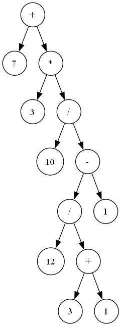

Learning the basics of interpreters. Starting with a basic calculator.

## How it currently works
```bash
calc>7 + 3 * (10 / (12 / (3 + 1) - 1))
digraph {
        node [shape=circle]
        nx00007FF7DEB18100 [label="+"]
        nx00007FF7DEB18040 [label="7"]
        nx00007FF7DEB18100 -> nx00007FF7DEB18040
        nx00007FF7DEB180F0 [label="*"]
        nx00007FF7DEB18050 [label="3"]
        nx00007FF7DEB180F0 -> nx00007FF7DEB18050
        nx00007FF7DEB180E0 [label="/"]
        nx00007FF7DEB18060 [label="10"]
        nx00007FF7DEB180E0 -> nx00007FF7DEB18060
        nx00007FF7DEB180D0 [label="-"]
        nx00007FF7DEB180B0 [label="/"]
        nx00007FF7DEB18070 [label="12"]
        nx00007FF7DEB180B0 -> nx00007FF7DEB18070
        nx00007FF7DEB180A0 [label="+"]
        nx00007FF7DEB18080 [label="3"]
        nx00007FF7DEB180A0 -> nx00007FF7DEB18080
        nx00007FF7DEB18090 [label="1"]
        nx00007FF7DEB180A0 -> nx00007FF7DEB18090
        nx00007FF7DEB180B0 -> nx00007FF7DEB180A0
        nx00007FF7DEB180D0 -> nx00007FF7DEB180B0
        nx00007FF7DEB180C0 [label="1"]
        nx00007FF7DEB180D0 -> nx00007FF7DEB180C0
        nx00007FF7DEB180E0 -> nx00007FF7DEB180D0
        nx00007FF7DEB180F0 -> nx00007FF7DEB180E0
        nx00007FF7DEB18100 -> nx00007FF7DEB180F0
}

result: 22
```
It generates the abstract syntax tree for the expression and a DOT description for the tree.

